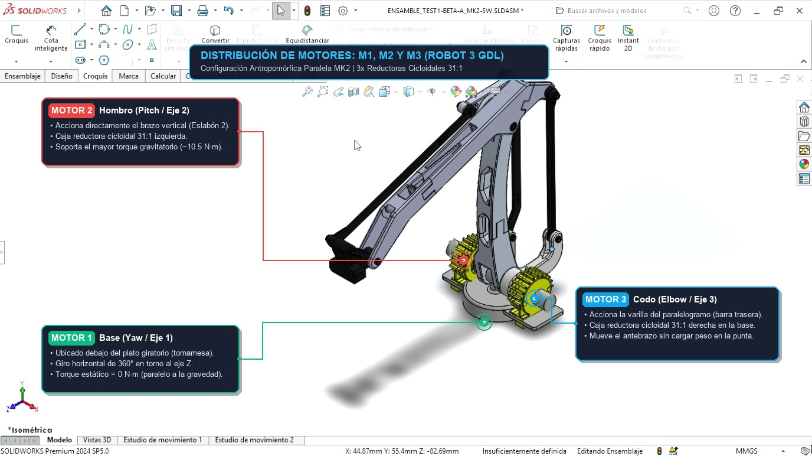
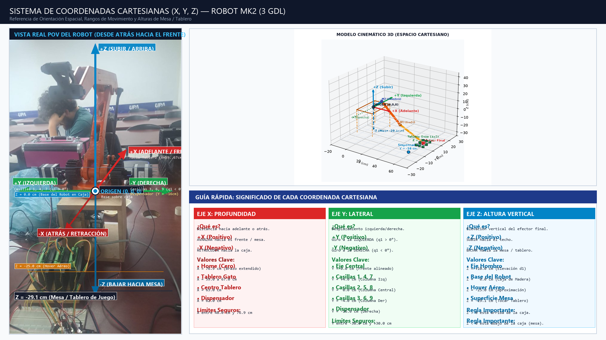
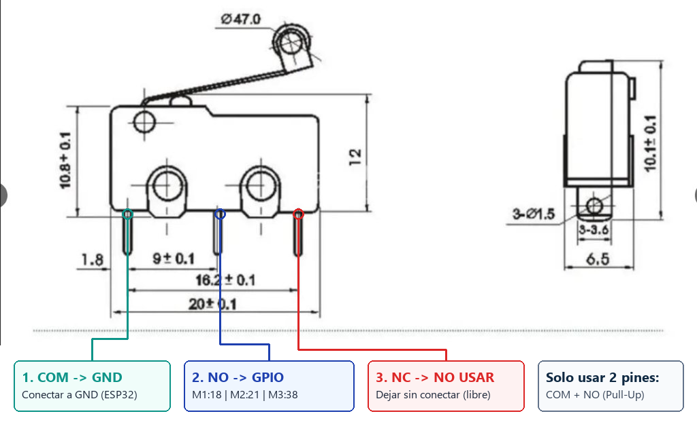
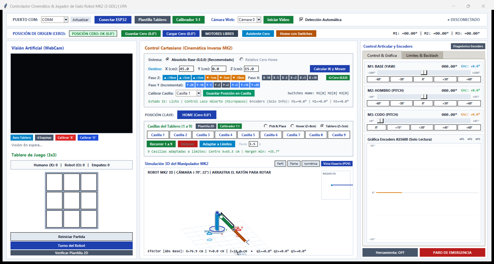
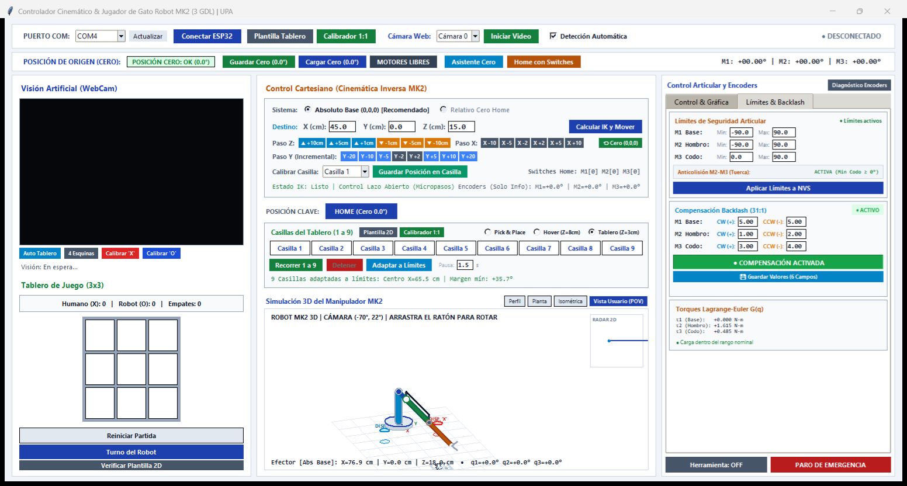
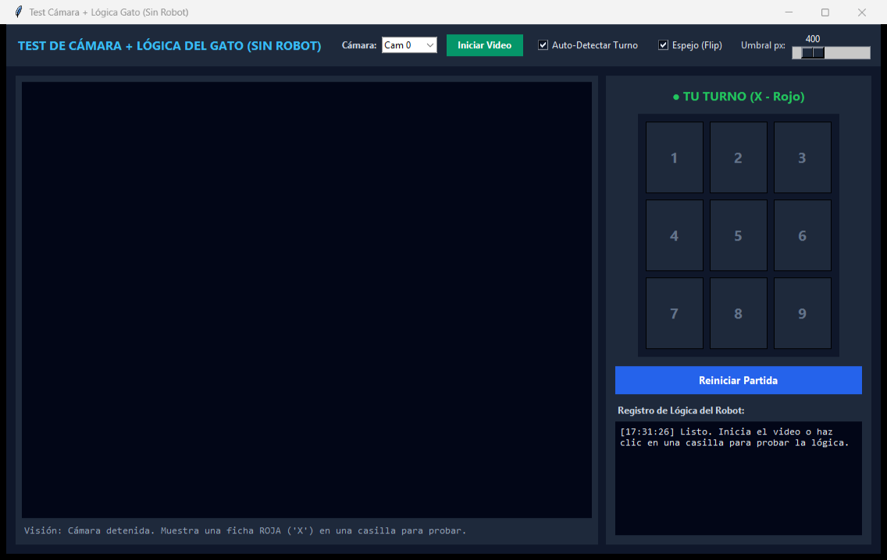
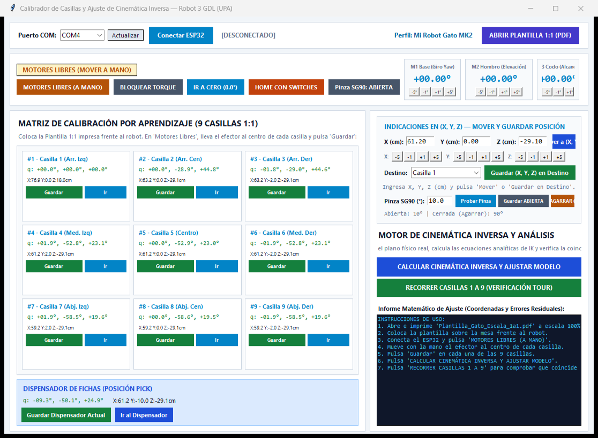

# Robot Manipulador de 3 GDL Jugador de Gato (Tic-Tac-Toe)

Sistema mecatrónico integral de **Brazo Robótico Articulado de 3 Grados de Libertad (3 GDL)** con **Control en Lazo Abierto por Micropasos (GPTimer DDS 40 kHz)**, **Homing Automático por Switches de Límite**, **Cinemática Inversa Analítica (Paralelogramo Desacoplado MK2)**, **Visión Artificial por WebCam** e inteligencia artificial **Minimax** para disputar partidas autónomas de **Gato (Tic-Tac-Toe)** en un tablero físico 3x3.

Desarrollado para la **Universidad Politécnica de Aguascalientes (UPA)**.

---

## 📌 Identificación Visual y Ejes de Coordenadas





### Descripción de los Actuadores y Mecanismo:
* **Motor 1 (M1 - Base / Yaw):** Montado verticalmente en la torreta giratoria de la base. Conduce la corona cicloidal `31:1` para el giro horizontal ($q_1$).
  * *Drivers:* `PUL=GPIO 4`, `DIR=GPIO 5`, `ENA=GPIO 6` | *Switch Home:* `GPIO 18`
* **Motor 2 (M2 - Hombro / Pitch):** Ubicado en el soporte lateral de la base. Acciona directamente el brazo principal ($a_2 = 32.922\text{ cm}$, ángulo $q_2$).
  * *Drivers:* `PUL=GPIO 15`, `DIR=GPIO 16`, `ENA=GPIO 17` | *Switch Home:* `GPIO 21`
* **Motor 3 (M3 - Codo / Pitch):** Ubicado en el lateral opuesto de la base. Transmite su rotación al antebrazo ($a_3 = 32.934\text{ cm}$, ángulo $q_3$) mediante un **mecanismo de paralelogramo articulado de 4 barras** con varilla de empuje.
  * *Drivers:* `PUL=GPIO 12`, `DIR=GPIO 13`, `ENA=GPIO 14` | *Switch Home:* `GPIO 38`
* **Herramienta / Pinza (Gripper):** Micro Servo **SG90** (PWM 50 Hz por LEDC en `GPIO 7`; `Café→GND`, `Rojo→5V`, `Naranja→GPIO 7`).

---

## 🔌 Cableado y Asignación de Pines (ESP32-S3)

### 1. Drivers TB6600 (Modo Cátodo Común) y Herramienta:
| Eje / Actuador | PUL+ (Pulsos DDS) | DIR+ (Sentido) | ENA+ (Torque) | Switch Home | Recurso Hardware ESP32-S3 | Pines Negativos |
|---|---|---|---|---|---|---|
| **Eje 1: Base (M1)** | **GPIO 4** | **GPIO 5** | **GPIO 6** | **GPIO 18** | GPTimer DDS 40 kHz (800 uSteps/rev) | GND Común ESP32 |
| **Eje 2: Hombro (M2)** | **GPIO 15** | **GPIO 16** | **GPIO 17** | **GPIO 21** | GPTimer DDS 40 kHz (800 uSteps/rev) | GND Común ESP32 |
| **Eje 3: Codo (M3)** | **GPIO 12** | **GPIO 13** | **GPIO 14** | **GPIO 38** | GPTimer DDS 40 kHz (800 uSteps/rev) | GND Común ESP32 |
| **Pinza Servo SG90** | **GPIO 7 (PWM 50Hz)** | — | — | — | LEDC Ch 0 (`10°` Abrir / `90°` Cerrar) | Café→GND, Rojo→5V |

### 2. Switches de Límite para Homing Automático (`SW_HOME`):
Los microswitches mecánicos de **3 pines** (`COM`, `NO`, `NC`) se conectan usando únicamente **2 pines** (el pin **`NC` queda libre / sin conectar**):



* **`COM` (Común)** → **`GND`** de la ESP32-S3
* **`NO` (Normalmente Abierto)** → **`GPIO`** correspondiente (`Pull-Up` interno, activo en BAJO `0V` al presionar)
* **`NC` (Normalmente Cerrado)** → **Sin conectar**

| Switch / Articulación | Pin `NO` (ESP32-S3) | Pin `COM` | Pin `NC` | Secuencia y Lógica de Auto-Homing al Encender |
|---|---|---|---|---|
| **SW_HOME_M3 (Codo)** | **GPIO 38** | **GND** | Libre | **1° en secuencia** \| Retrocede hacia atrás (`CCW`) hasta presionar (`0V`), libera `+1.5°` y fija `0.0°` |
| **SW_HOME_M2 (Hombro)** | **GPIO 21** | **GND** | Libre | **2° en secuencia** \| Retrocede hacia atrás (`CCW`) hasta presionar (`0V`), libera `+1.5°` y fija `0.0°` |
| **SW_HOME_M1 (Base)** | **GPIO 18** | **GND** | Libre | **3° en secuencia** \| Barrido oscilatorio creciente (`±10°, ±20°, ±30°...`) hasta tocar switch frontal, libera `1.5°` y fija `0.0°` |

### 3. Encoders Magnéticos AS5600 (3 Buses I2C Dedicados — Telemetría):
| Sensor / Articulación | SDA (Datos) | SCL (Reloj) | Alimentación | Función en Firmware |
|---|---|---|---|---|
| **Encoder 1 (M1 Base)** | **GPIO 1** | **GPIO 2** | 3.3V / GND | Bus I2C Dedicado 1 \| Telemetría `ENC_INFO` (solo lectura) |
| **Encoder 2 (M2 Hombro)** | **GPIO 8** | **GPIO 9** | 3.3V / GND | Bus I2C Dedicado 2 \| Telemetría `ENC_INFO` (solo lectura) |
| **Encoder 3 (M3 Codo)** | **GPIO 10** | **GPIO 11** | 3.3V / GND | Bus I2C Dedicado 3 \| Telemetría `ENC_INFO` (solo lectura) |

> **Nota de Control Motriz:** Cada motor NEMA 17 opera a **4 micropasos (800 pulsos/rev)** con reductor cicloidal **31:1**, equivalente a **24,800 micropasos/rev** en la articulación (**68.89 pasos/°**). Las rampas trapezoidales se actualizan a **100 Hz** (límite de frecuencia en firmware: `3000 Hz`).

---

## 🧮 Modelado Cinemático y Cinemática Inversa (Paralelogramo Desacoplado MK2)

En el manipulador MK2, el motor **M3** está fijo en la base y acciona el antebrazo ($a_3$) mediante una varilla paralela, por lo que la inclinación de $a_3$ respecto a la horizontal es **independiente de $q_2$** y depende directamente de $q_3$.

### Parámetros Geométricos Reales (SolidWorks y Mesa):
* **Elevación vertical Base → Hombro ($d_1$):** `18.0 cm` *(base elevada sobre mesa)*.
* **Offset radial del Hombro ($a_1$):** `11.0 cm`.
* **Brazo Principal ($a_2$):** `32.922 cm`.
* **Antebrazo + Efector ($a_3$):** `32.934 cm`.
* **Plano de trabajo en mesa:** `pick_z = -29.1 cm`, `place_z = -29.1 cm`, `hover_z = -25.0 cm`.

### 1. Cinemática Directa (FK):
$$r = a_1 + a_2 \cos(q_2) + a_3 \cos(q_3)$$
$$X = r \cos(q_1), \qquad Y = r \sin(q_1), \qquad Z = d_1 + a_2 \sin(q_2) - a_3 \sin(q_3)$$

### 2. Cinemática Inversa Analítica (IK):
Dado un punto objetivo $(X, Y, Z)$ en centímetros:

1. **Giro de Base ($q_1$):**
   $$q_1 = \text{atan2}(Y, X)$$
2. **Proyección en el Plano Radial del Hombro:**
   $$r_{xy} = \sqrt{X^2 + Y^2}, \qquad dr = r_{xy} - a_1, \qquad dz = Z - d_1, \qquad \text{dist} = \sqrt{dr^2 + dz^2}$$
3. **Acotamiento Suave de Envolvente:**
   $$\text{max\_reach} = a_2 + a_3 = 65.856\text{ cm}, \qquad \text{max\_dr} = \sqrt{\text{max\_reach}^2 - dz^2}$$
   *(Si $dr > \text{max\_dr}$, se proyecta al radio alcanzable en la misma dirección angular $q_1$ para evitar bloqueos en frontera).*
4. **Triángulo de Eslabones (Ley de Cosenos):**
   $$\cos(\Delta\theta) = \frac{\text{dist}^2 - a_2^2 - a_3^2}{2 \cdot a_2 \cdot a_3}, \qquad \cos(\psi) = \frac{\text{dist}^2 + a_2^2 - a_3^2}{2 \cdot a_2 \cdot \text{dist}}, \qquad \beta = \text{atan2}(dz, dr)$$
5. **Ramas Cinemáticas (Codo Arriba / Codo Abajo):**
   * **Codo Arriba (*Elbow-Up*):** $\theta_2 = \beta + \psi,\quad \theta_3 = \theta_2 - \Delta\theta \implies q_2 = \theta_2,\quad q_3 = -\theta_3$
   * **Codo Abajo (*Elbow-Down*):** $\theta_2 = \beta - \psi,\quad \theta_3 = \theta_2 + \Delta\theta \implies q_2 = \theta_2,\quad q_3 = -\theta_3$

### Límites Articulares Activos (`robot_config.json`):
* **M1 (Base / Yaw):** $[-90.0^\circ, +90.0^\circ]$
* **M2 (Hombro / Pitch):** $[-90.0^\circ, +90.0^\circ]$
* **M3 (Codo / Pitch):** $[0.0^\circ, +90.0^\circ]$
* **Dinámica:** `2400 Hz` velocidad máx., `2500 Hz/s` aceleración.
* **Compensación de Holgura (Backlash):** Habilitada (`M1: 5.0/5.0`, `M2: 1.0/2.0`, `M3: 3.0/4.0` vueltas motor CW/CCW).

---

## 🖥️ Interfaz Gráfica Visual (`gui_robot_gato.py`)

La interfaz principal centraliza el control cartesiano por Cinemática Inversa, la simulación 3D en tiempo real, la visión artificial y la configuración de seguridad del robot:

### 1. Panel Principal: Control Cartesiano (IK), Visión y Simulación 3D


* **Barra Superior y Homing:** Conexión serial con el ESP32-S3, control de WebCam, botón **`Home con Switches`** (secuencia `M3 → M2 → M1`) y **`MOTORES LIBRES`**.
* **Panel Izquierdo (Visión Artificial y Tablero 3x3):** Video en vivo con detección HSV de fichas `'X'` / `'O'`, tablero interactivo 3x3, marcador de partidas y disparo de turno por IA Minimax.
* **Panel Central (Control Cartesiano IK y Simulación 3D):**
  * Ingreso directo de coordenadas `(X, Y, Z)` con **`Calcular IK y Mover`**, botones incrementales (*Jog*) en `X`, `Y` y `Z`, monitoreo en vivo de `Switches Home: M1[0] M2[0] M3[0]` y acceso directo a las **Casillas 1 a 9**.
  * **Simulación 3D del Manipulador MK2:** Render interactivo rotatorio con vistas rápidas (`Perfil`, `Planta`, `Isométrica`, `Vista Usuario POV`), dispensadores `'O'`/`'X'` y **Radar 2D** superior.
* **Panel Derecho (`Control & Gráfica`):** Control articular individual de `M1`, `M2` y `M3`, activación del electroimán (`Herramienta`) y botón de **`PARO DE EMERGENCIA`**.

### 2. Pestaña de Seguridad: Límites Articulares, Backlash y Dinámica


* **Límites de Seguridad Articular:** Ajuste en vivo de rangos seguros (`M1: [-90°, +90°]`, `M2: [-90°, +90°]`, `M3: [0°, +90°]`) con protección anticolisión M2–M3.
* **Compensación Backlash (31:1):** Configuración independiente de vueltas extra `CW (+)` y `CCW (-)` por motor para absorber la holgura mecánica al invertir el sentido de giro.
* **Torques Lagrange-Euler $G(q)$:** Cálculo en tiempo real del torque estático en cada articulación ($\tau_1, \tau_2, \tau_3$ en $\text{N}\cdot\text{m}$).

---

## 📷 Sistema de Visión Artificial por Cámara (`Captura-de-imagen`)

El sistema integra los módulos de visión de [`pame18lopez/Captura-de-imagen`](https://github.com/pame18lopez/Captura-de-imagen) (`board_detector.py`, `piece_detector.py`, `board_config.json`, `piece_config.json`):



* **Detección de Tablero por Homografía (`BoardDetector`):** Corrige la perspectiva de la cámara hacia una vista superior plana de `450x450` px (`Auto Tablero` por contornos o calibración manual de **`4 Esquinas`** guardada en `board_config.json`).
* **Segmentación HSV + Morfología (`PieceDetector`):**
  * **Fichas Humano (`'X'` / Gato - Rojo):** Rangos `H ∈ [0, 10] ∪ [168, 180]`, `S ≥ 80`, `V ≥ 50`.
  * **Fichas Robot (`'O'` / Ratón - Azul):** Rango `H ∈ [95, 135]`, `S ≥ 70`, `V ≥ 50`.
  * Incluye limpieza morfológica (`MORPH_OPEN` + `MORPH_DILATE`), umbral de ocupación del `7.5%` del área de la casilla, buffer temporal de estabilidad (`6` de `8` cuadros) y calibración de color por clic (**`Calibrar 'X'`** / **`Calibrar 'O'`** en `piece_config.json`).

---

## 🎯 Cómo Calibrar el Robot y las Casillas (`calibrador_casillas.py`)

Para asegurar que el efector final coincida con exactitud física sobre las 9 casillas y el dispensador:



1. **Referenciado de Origen (`Home con Switches`):**
   En la interfaz principal, pulsa **`Home con Switches`** para que el robot busque automáticamente los 3 switches de límite en orden **`M3 (GPIO 38) → M2 (GPIO 21) → M1 (GPIO 18)`** y establezca `0.0°`.
2. **Imprimir Plantilla 1:1:**
   Abre e imprime [`Plantilla_Gato_Escala_1a1.pdf`](Plantilla_Gato_Escala_1a1.pdf) en **Escala 100% (Sin Ajustar)** y colócala centrada frente al robot sobre la mesa (`Z = -29.1 cm`).
3. **Calibración Teach-In (`calibrar_casillas.bat`):**
   * Conecta el ESP32-S3 y pulsa **`MOTORES LIBRES (A MANO)`**.
   * Lleva manualmente el efector al centro de cada **Casilla (1 a 9)** y del **Dispensador de Fichas**, y pulsa **`Guardar`** en cada una (se almacena en `casillas_calibradas.json`).
4. **Ajuste y Verificación de Cinemática Inversa:**
   * Pulsa **`CALCULAR CINEMÁTICA INVERSA Y AJUSTAR MODELO`** para verificar las coordenadas $(X, Y, Z)$ y residuales.
   * Pulsa **`RECORRER CASILLAS 1 A 9 (VERIFICACIÓN TOUR)`** para comprobar que el robot recorre las 9 casillas con precisión.

---

## 📄 Manual Técnico en PDF
Consulta el documento completo listo para imprimir en el repositorio:
* 📄 **[Manual_Robot_3GDL_Gato.pdf](Manual_Robot_3GDL_Gato.pdf)**

---

## 🚀 Guía de Instalación y Puesta en Marcha

### 1. Clonar el Repositorio
```bash
git clone https://github.com/JK897933/robot_3gdl.git
cd robot_3gdl
```

### 2. Instalar Dependencias de Python
Ejecuta `instalar_dependencias.bat` o:
```bash
pip install -r requirements.txt
```

### 3. Compilar y Flashear el Firmware al ESP32-S3
Ejecuta `flashear_firmware_esp32.bat` (o `.\build.ps1 robot_3gdl flash` desde la raíz del proyecto).

### 4. Herramientas Disponibles
| Archivo | Descripción |
|---|---|
| `iniciar_interfaz.bat` (`gui_robot_gato.py`) | Interfaz gráfica principal: Homing con switches, IK en tiempo real, visión HSV y juego contra IA Minimax. |
| `calibrar_casillas.bat` (`calibrador_casillas.py`) | Calibrador de las 9 casillas y dispensador hacia `casillas_calibradas.json`. |
| `test_camara_gato.bat` (`test_camara_gato.py`) | Prueba independiente de cámara (detección HSV de fichas `'X'`/`'O'` e IA Minimax) sin conectar el ESP32. |
| `Plantilla_Gato_Escala_1a1.pdf` | Plantilla imprimible escala 1:1 para alineación física del tablero. |

---

## 👨‍💻 Autor
* **Estudiante:** Juan Jesus (`up230061@alumnos.upa.edu.mx`)
* **Institución:** Universidad Politécnica de Aguascalientes (UPA)
