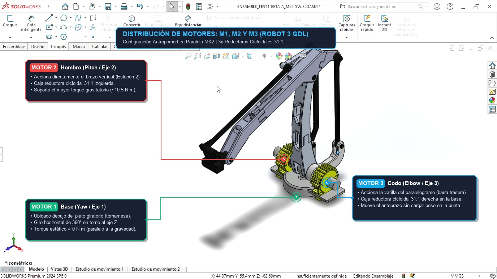

# Robot Manipulador de 3 GDL Jugador de Gato (Tic-Tac-Toe)

Sistema mecatrónico integral de **Brazo Robótico Articulado de 3 Grados de Libertad (3 GDL)** con **Servocontrol en Lazo Cerrado (Closed-Loop Stepper)**, **Visión Artificial por WebCam** y algoritmo de inteligencia artificial para disputar autónomamente partidas de **Gato (Tic-Tac-Toe / Tres en Raya)** contra un humano en un tablero físico de 3x3 casillas.

Desarrollado para la **Universidad Politécnica de Aguascalientes (UPA)**.

---

## 📌 Identificación Visual de los Motores y Articulaciones



### Descripción de los Actuadores:
* **Motor 1 (M1 - Base / Yaw):** Motor montado en posición vertical en la base giratoria. Conduce la corona cicloidal para el giro horizontal ($\pm 60^\circ$).
  * *Pines ESP32-S3:* `PUL=GPIO 4`, `DIR=GPIO 5`, `ENA=GPIO 6`.
  * *Encoder AS5600:* `SDA=GPIO 1`, `SCL=GPIO 2` (Bus I2C Dedicado 1).
* **Motor 2 (M2 - Hombro / Pitch):** Ubicado en el lateral de la base. Conduce directamente el eslabón brazo principal ($a_2$).
  * *Pines ESP32-S3:* `PUL=GPIO 15`, `DIR=GPIO 16`, `ENA=GPIO 17`.
  * *Encoder AS5600:* `SDA=GPIO 8`, `SCL=GPIO 9` (Bus I2C Dedicado 2).
* **Motor 3 (M3 - Codo / Pitch):** Ubicado en el lateral opuesto de la base. Transmite el movimiento hacia el antebrazo ($a_3$) mediante un mecanismo de paralelogramo articulado con varilla de empuje.
  * *Pines ESP32-S3:* `PUL=GPIO 12`, `DIR=GPIO 13`, `ENA=GPIO 14`.
  * *Encoder AS5600:* `SDA=GPIO 10`, `SCL=GPIO 11` (Bus I2C Dedicado 3).
  * *Seguridad Anticolisión:* Acotado para impedir que la tuerca mecánica golpee el brazo.
* **Herramienta / Gripper:** Electroimán de 12V gobernado mediante transistor/relé en `GPIO 7`.

---

## 🚀 Guía de Instalación y Puesta en Marcha Rápida (100% Funcional)

### Paso 1: Clonar o Descargar el Repositorio
```bash
git clone https://github.com/up230061/robot_3gdl.git
cd robot_3gdl
```

### Paso 2: Instalar Dependencias de Python
Puedes hacer doble clic en el archivo `instalar_dependencias.bat` o ejecutar:
```bash
python -m pip install --upgrade pip
pip install -r requirements.txt
```

### Paso 3: Flashear el Firmware C al ESP32-S3
Puedes hacer doble clic en `flashear_firmware_esp32.bat` o compilar y flashear con ESP-IDF:
```powershell
powershell -Command "& 'C:\esp\v6.1\esp-idf\export.ps1'; idf.py -p COM4 flash"
```
*(Cambia `COM4` por el puerto USB nativo de tu ESP32).*

### Paso 4: Ejecutar la Interfaz Gráfica
Haz doble clic en `iniciar_interfaz.bat` o ejecuta:
```bash
python gui_robot_gato.py
```

---

## 📄 Manual Técnico en PDF
El proyecto cuenta con su manual técnico de 5 páginas completamente estructurado y listo para imprimir:
* 📄 **[Manual_Robot_3GDL_Gato.pdf](Manual_Robot_3GDL_Gato.pdf)**

Incluye:
* Diagrama esquemático eléctrico.
* Tablas de conexión de los 3 drivers TB6600 y los 3 encoders AS5600.
* Fotografía y cinemática de los motores M1, M2 y M3.
* Cálculo cinemático Denavit-Hartenberg (DH) y Cinemática Inversa analítica.
* Coordenadas $(X, Y, Z)$ y torques estáticos de las 9 casillas.
* Calibración de visión WebCam en espacio HSV.
* Rúbrica técnica de evaluación con puntuación 100/100.

---

## 🔌 Cableado y Asignación de Pines (ESP32-S3)

### 1. Drivers TB6600 (Modo Cátodo Común):
| Eje / Articulación | PUL+ (Pulsos PWM) | DIR+ (Sentido) | ENA+ (Torque) | Recurso Hardware ESP32 | Pines Negativos |
|---|---|---|---|---|---|
| **Eje 1: Base (M1)** | **GPIO 4** | **GPIO 5** | **GPIO 6** | LEDC Timer 0 / Ch 0 | GND Común ESP32 |
| **Eje 2: Hombro (M2)** | **GPIO 15** | **GPIO 16** | **GPIO 17** | LEDC Timer 1 / Ch 1 | GND Común ESP32 |
| **Eje 3: Codo (M3)** | **GPIO 12** | **GPIO 13** | **GPIO 14** | LEDC Timer 2 / Ch 2 | GND Común ESP32 |
| **Gripper / Imán** | **GPIO 7** | — | — | Salida Digital | GND Común ESP32 |

### 2. Encoders Magnéticos AS5600 (3 Buses I2C Dedicados Sin Multiplexor):
| Sensor | SDA (Datos) | SCL (Reloj) | Alimentación | Tipo de Bus |
|---|---|---|---|---|
| **Encoder 1 (M1 Base)** | **GPIO 1** | **GPIO 2** | 3.3V / GND | Bus I2C Dedicado 1 (~250 kHz) |
| **Encoder 2 (M2 Hombro)** | **GPIO 8** | **GPIO 9** | 3.3V / GND | Bus I2C Dedicado 2 (~250 kHz) |
| **Encoder 3 (M3 Codo)** | **GPIO 10** | **GPIO 11** | 3.3V / GND | Bus I2C Dedicado 3 (~250 kHz) |

---

## 🧮 Modelado Cinemático y Cinemática Inversa

El robot posee configuración antropomórfica RRR desacoplada:

1. **Ángulo de Base ($q_1$):**
   $$q_1 = \text{atan2}(Y, X)$$

2. **Alcance en el Plano Sagital ($r, z_e$):**
   $$r = \sqrt{X^2 + Y^2} - a_1$$
   $$z_e = Z - d_1$$

3. **Ángulo de Codo ($q_3$):**
   $$D = \frac{r^2 + z_e^2 - a_2^2 - a_3^2}{2 \cdot a_2 \cdot a_3}$$
   $$q_3 = \text{atan2}(-\sqrt{1 - D^2}, D)$$

4. **Ángulo de Hombro ($q_2$):**
   $$q_2 = \text{atan2}(z_e, r) - \text{atan2}(a_3 \sin(q_3), a_2 + a_3 \cos(q_3))$$

---

## 🗂️ Estructura del Repositorio

```
robot_3gdl/
├── main/
│   ├── main.c                          # Firmware completo en C (ESP-IDF v6.1)
│   └── CMakeLists.txt                  # Configuración de compilación del componente main
├── CMakeLists.txt                      # CMakeLists principal del proyecto ESP-IDF
├── sdkconfig                           # Configuración de periféricos y reloj ESP32-S3
├── gui_robot_gato.py                   # Software de Interfaz Gráfica (Python / Tkinter / OpenCV)
├── robot_config.json                   # Perfiles mecánicos, cinemáticos y calibración del cero
├── robot_marcado_m1_m2_m3.jpg          # Fotografía de referencia con la identificación de motores
├── Manual_Robot_3GDL_Gato.pdf          # Manual técnico imprimible de 5 páginas
├── generate_pdf_manual.py              # Script en ReportLab para regenerar el PDF
├── plantilla_gato_escala_1a1.html      # Plantilla imprimible a escala 1:1 del tablero de juego
├── requirements.txt                    # Dependencias de librerías de Python
├── instalar_dependencias.bat           # Instalador automático en 1 clic
├── iniciar_interfaz.bat                # Lanzador de la aplicación en 1 clic
├── flashear_firmware_esp32.bat         # Flasheo directo al ESP32 en 1 clic
└── README.md                           # Documentación técnica completa
```

---

## 👨‍💻 Autor y Contacto
* **Estudiante:** Juan Jesus
* **Correo Institucional:** `up230061@alumnos.upa.edu.mx`
* **Institución:** Universidad Politécnica de Aguascalientes (UPA)
